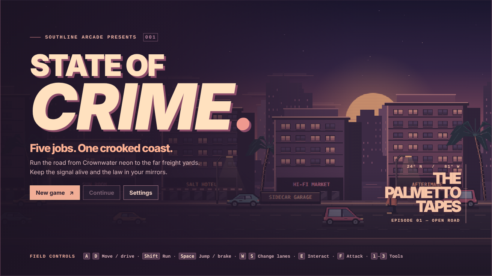

# State of Crime: The Palmetto Tapes

**Five jobs. One crooked coast.** Take a courier run out of Crownwater, shake the police across Sunsplice Keys, and find out what Breakwater Yard is keeping off the air.



## Play in a browser

Install Node.js 22.12 or newer, then run:

```sh
npm ci
npm run build
npm run preview -- --port 4173
```

Open **http://localhost:4173/** in a modern desktop browser and choose **New Game**. Move right to meet Mara and press **E** when prompted. For development, use `npm run dev`; for unit checks, use `npm test`.

Host the generated `dist/` directory on any static HTTP host. It uses relative asset URLs and needs no server-side API, external content, or account. For GitHub Pages, choose **GitHub Actions** as the Pages source; the workflow deploys on push to `main`.

## Controls

| Input | On foot | Driving |
| --- | --- | --- |
| **A / D** or **← / →** | Move | Accelerate / reverse direction |
| **Shift** | Sprint | — |
| **Space** | Jump | Brake |
| **W / S** or **↑ / ↓** | **W / ↑** also jumps | Switch traffic lanes |
| **E** | Talk, interact, enter vehicle | Exit vehicle or use nearby contact/refuge |
| **F**, **1–3** | Attack; select a tool | — |
| **Esc** or **P** | Pause | Pause |

Borrowing a vehicle can attract police. Keep moving to leave their search area, or slow down at Sidecar Garage or Bluehour Refuge and press **E** to hide. The HUD shows your next objective and which way to go. Sidecar upgrades apply to garage vehicles; stage your selected ride to take it out.

Sidecar has a garage in Crownwater and an outpost just east of Bluehour Refuge. Bring a Sidecar ride to a driving job to use your upgrades, or take the free Sable loaner.

Checkpoints save at job contacts when you accept, when you earn a payout, and when you purchase or service a ride. **Continue from checkpoint** keeps your campaign progress, cash, vehicles, and upgrades; any active job restarts and pursuit clears. If browser storage is unavailable, the latest checkpoint only lasts until you close or refresh the tab. Settings save separately.

## More

- [World map](docs/WORLD_MAP.md) and [design](docs/GAME_DESIGN_DOCUMENT.md)
- [Mission guide](docs/MISSION_DESIGN.md) and [controls/balance values](docs/BALANCING.md)
- [Browser playtest](docs/PLAYTEST_REPORT.md), [screenshots](docs/screenshots/) and [release scope](docs/RELEASE_NOTES.md)

This is an original project. No affiliation with Rockstar Games, and no GTA game assets are used. State of Crime is an uncleared working title.
